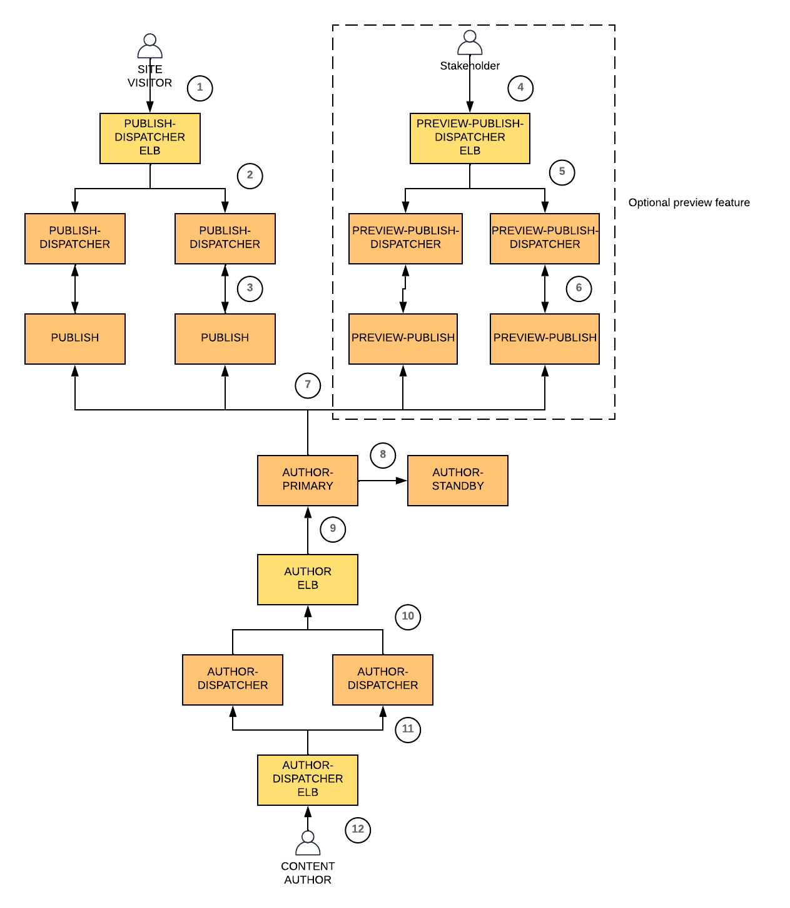

Communication Flow
------------------

The communication between components within AEM architecture is uses HTTPS by default. The intention is obviously to encourage users to use HTTPS for security reason.

<table>

<tr>
<td valign="top">

</td>
</tr>
<tr>
<td valign="top">
<ol>
<li>
<strong>From Site Visitor to  Publish-Dispatcher ELB</strong>

Site visitor can connect to Publish-Dispatcher ELB via HTTPS on port 443. Alternatively.

However, most users often have a layer (e.g. CDN/routing) sitting in front of the AEM architecture, which connects to AEM Publish-Dispatcher ELB only via HTTPS.

</li>
<li>
<strong>From Publish-Dispatcher ELB to Publish-Dispatcher EC2 instance</strong>

Publish-Dispatcher ELB connects to Publish-Dispatcher EC2 instance via HTTPS on port 443.

Publish-Dispatcher ELB health monitoring checks Publish-Dispatcher EC2 instance only via HTTPS on port 443, at path <code>/system/health?tags=shallow</code> .

</li>
<li>
<strong>From Publish-Dispatcher EC2 instance to Publish EC2 instance</strong>

AEM Publish-Dispatcher is configured to point to AEM Publish as its farm's website render via HTTPS on port 5433 with <code>secure</code> setting enabled.

<strong>From Publish EC2 instance to Publish-Dispatcher EC2 instance</strong>

AEM Publish is configured with a flush agent that points to AEM Publish-Dispatcher via HTTPS on port 443.

</li>
<li>
<strong>(Optional) From Stakeholder to Preview-Publish-Dispatcher ELB</strong>

Stakeholders can connect to Preview-Publish-Dispatcher ELB via HTTPS on port 443. Alternatively.

</li>
<li>
<strong>(optional) From Preview-Publish-Dispatcher ELB to Preview-Publish-Dispatcher EC2 instance</strong>

Preview-Publish-Dispatcher ELB connects to Preview-Publish-Dispatcher EC2 instance via HTTPS on port 443.

Preview-Publish-Dispatcher ELB health monitoring checks Preview-Publish-Dispatcher EC2 instance only via HTTPS on port 443, at path <code>/system/health?tags=shallow</code> .

</li>
<li>
<strong>(Optional) From Publish-Dispatcher EC2 instance to Publish EC2 instance</strong>

AEM Preview-Publish-Dispatcher is configured to point to AEM Preview-Publish as its farm's website render via HTTPS on port 5433 with <code>secure</code> setting enabled.

<strong>From Preview-Publish EC2 instance to Preview-Publish-Dispatcher EC2 instance</strong>

AEM Preview-Publish is configured with a flush agent that points to AEM Preview-Publish-Dispatcher via HTTPS on port 443.

</li>
<li>
<strong>From Author-Primary EC2 instance to Publish EC2 instance</strong>

AEM Author is configured with replication agent that points AEM Publish via HTTPS on port 5433.

</li>
<li>
<strong>From Author-Primary EC2 instance to Author-Standby EC2 instance</strong>

Author-Standby is configured with <code>primary.host</code> pointing to Author-Primary. Data synchronisation is run through port 8023, with <code>secure</code> option set to true.

</li>
<li>
<strong>From Author ELB to Author-Primary EC2 instance</strong>

Author ELB connects to Author-Primary EC2 instance via HTTPS on port 5432.

Author ELB health monitoring checks Author-Primary EC2 instance only via HTTPS on port 5432, at path <code>/system/health?tags=shallow</code> .

</li>
<li>
<strong>From Author-Dispatcher EC2 instance to Author ELB</strong>

AEM Author-Dispatcher is configured to point to AEM Author ELB as its farm's website render via HTTPS on port 443 with <code>secure</code> setting enabled.

</li>
<li>
<strong>From Author-Dispatcher ELB to Author-Dispatcher EC2 instance</strong>

Author-Dispatcher ELB connects to Author-Dispatcher EC2 instance via HTTPS on port 443.

Author-Dispatcher ELB health monitoring checks Author-Dispatcher EC2 instance only via HTTPS on port 443, at path <code>/system/health?tags=shallow</code> .

</li>
<li>
<strong>From Content Author to Author-Dispatcher ELB</strong>

Site visitor can connect to Author-Dispatcher ELB via HTTPS on port 443. Alternatively.

However, most users often have a layer (e.g. routing via a reverse proxy) sitting in front of the AEM architecture, which connects to AEM Author-Dispatcher ELB only via HTTPS.

</li>
</ol>
</td>
</tr>
</table>
